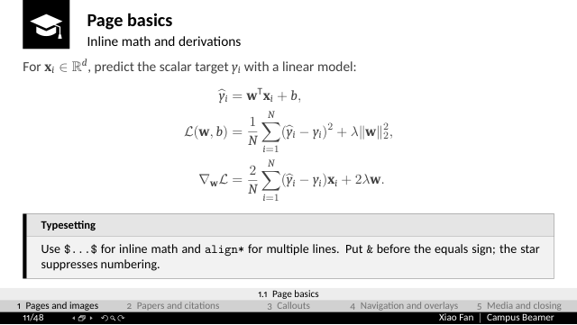
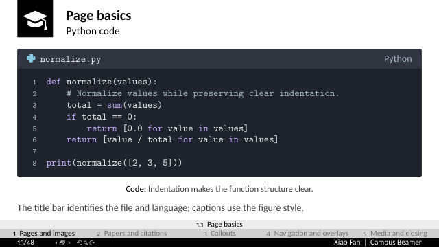
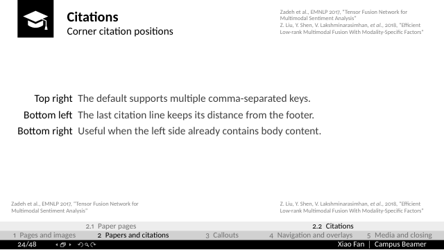
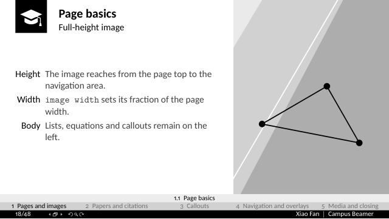

# Campus Beamer

{ .campus-beamer-brand width=480 }

**A clean, elegant, agent-oriented Beamer template for academic presentations.** Turn an outline and prepared research materials into consistently typeset PDF and PowerPoint slides, with speaker notes and reusable TeX source.

[GitHub](https://github.com/AnikiFan/campus-beamer){ .md-button .md-button--primary }
[Download releases](https://github.com/AnikiFan/campus-beamer/releases/latest){ .md-button }
[Usage guide](https://github.com/AnikiFan/campus-beamer/blob/main/docs/usage.md){ .md-button }

## Motivation

An agent can produce a deck quickly, but a directly generated presentation may have inconsistent typography, weak academic structure, and references that are difficult to verify or reuse. Campus Beamer gives the agent a stable layout system and gives the author an inspectable source that can be revised and carried into future talks.

The workflow starts with the argument and supporting material. An expanded outline is reviewed before slides are generated; shared Beamer layouts then keep typography, navigation, citations, and speaker notes consistent.

## Six themes, one workflow

The default **General** theme uses a black-and-white palette, an original graduation-cap emblem, and the Campus Beamer wordmark. The same presentation structure can also use Tokyo Night, EVA, undefined, Tsinghua University, or Peng Cheng Laboratory themes.

<figure markdown="1">
{ loading=lazy }
<figcaption>General · Black and white</figcaption>
</figure>

<figure markdown="1">
{ loading=lazy }
<figcaption>Tokyo Night · Dark palette</figcaption>
</figure>

<figure markdown="1">
{ loading=lazy }
<figcaption>EVA · Red and black</figcaption>
</figure>

<figure markdown="1">
{ loading=lazy }
<figcaption>undefined · Yellow palette</figcaption>
</figure>

<figure markdown="1">
{ loading=lazy }
<figcaption>Tsinghua University</figcaption>
</figure>

<figure markdown="1">
{ loading=lazy }
<figcaption>Peng Cheng Laboratory</figcaption>
</figure>

Click any preview to enlarge it. Both **16:9 and 4:3** formats are supported. These are community project themes, not official institutional templates; theme assets retain their respective [sources and usage terms](https://github.com/AnikiFan/campus-beamer#许可与素材).

## Built for research talks

Shared layouts support equations, code, figures, callouts, paper citations, progressive reveals, and navigation. The examples below show the English General theme.

<figure markdown="1">
{ loading=lazy }
<figcaption>Equations and structured layouts</figcaption>
</figure>

<figure markdown="1">
{ loading=lazy }
<figcaption>Code presentation</figcaption>
</figure>

<figure markdown="1">
{ loading=lazy }
<figcaption>Linked paper citations</figcaption>
</figure>

<figure markdown="1">
{ loading=lazy }
<figcaption>Figures alongside text</figcaption>
</figure>

- **PDF and PowerPoint.** LaTeX handles typesetting; the default PPTX preserves slide appearance as rendered images, with links, embedded video, and speaker notes.
- **Native speaker notes.** Notes are authored in TeX and exported to PowerPoint; a separate PDF layout can place notes beside each slide.
- **Traceable references.** Literature tools help retrieve DBLP BibTeX entries and citation-count snapshots for verification.
- **Reusable source and themes.** Revise the outline and TeX source for the next talk, or create a theme with its own palette and assets.

!!! note "Experimental editable export"
    The current `main` branch also provides `make pptx-editable` for editable text, footers, and callouts. Emblems can be moved or replaced independently; equations and other complex content remain images, and recipients need the corresponding fonts. This is distinct from the default image-based PPTX export. See the [editable export guide](https://github.com/AnikiFan/campus-beamer/blob/main/docs/usage.md#可编辑文字导出实验性).

## From outline to slides

1. Clone the repository or unpack a release, then open it in an agent that can read local files and run commands.
2. Run `make init`, fill in `outline.md`, and place papers, figures, and results in `materials/`.
3. Ask the agent to create the presentation. Review its expanded outline before slide generation.
4. Let the agent arrange the slides and notes, check the layout, and export PDF and PPTX.

Local workflows include environment checks and page previews, with Docker setup and an Overleaf import package also documented. See [installation](https://github.com/AnikiFan/campus-beamer/blob/main/docs/installation.md) and [workflow options](https://github.com/AnikiFan/campus-beamer/blob/main/docs/workflows.md) for requirements and limitations.

The [latest stable release](https://github.com/AnikiFan/campus-beamer/releases/latest) provides ready-made examples and source downloads. The [repository](https://github.com/AnikiFan/campus-beamer) documents ongoing development.
